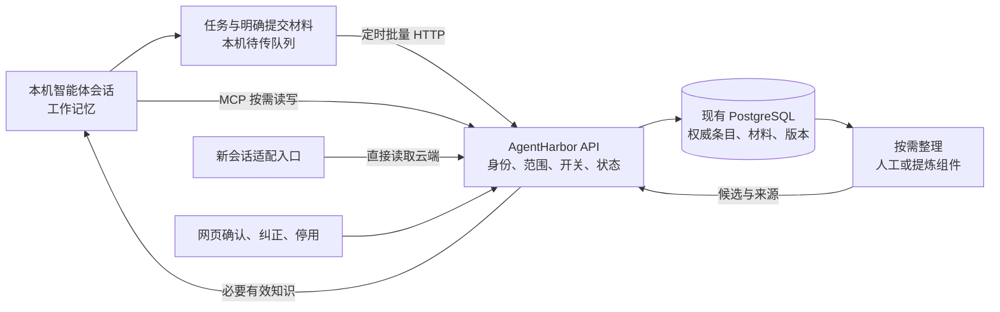

# AgentHarbor 下一阶段技术方案：可控的四类记忆

日期：2026-11-07

状态：四类记忆、独立条目、生命周期及项目或全局范围已获用户确认。本文是后续实现方案，不是完成记录；本轮只更新文档，不改代码、不部署、不迁移数据。存储落点、控件布局和分阶段实现属于技术建议，未确认的默认值与采集范围单独列出。

对应需求：[完整需求](requirements.md)、[下一阶段需求与操作](next-stage-requirements.md)。[v1](technical-design-v1.md)保留首版历史设计；后续记忆路径以本文为准。[首版验收记录](local-acceptance-a.md)不能作为本文新增能力的验收证据。

## 1 现状与改造边界

当前实际接入是每项目一份 MemoryCore L3 文档：网页整份保存，MCP 读整份或追加一段；没有独立条目的候选、有效、停用状态。后端计算的内容哈希用于表示版本，但网页更新没有要求提交旧版本，进程内互斥锁也不能阻止旧页面覆盖新内容。依据：[客户端](../../server/internal/agentharbormemory/client.go)、[记忆接口](../../server/internal/handler/agentharbor_memory.go)。

当前 MCP 只在调用工具时访问 HTTP。另有连接程序按周期下载记忆缓存，并在 `UserPromptSubmit` 提供缓存；这不是新会话直接取云端的目标行为。任务链路可保留：Hook → 本机持久队列 → 每 30 秒批量 HTTP 上传 → 任务页。依据：[MCP](../../tools/agentharbor-connector/memory_mcp.py)、[连接程序](../../tools/agentharbor-connector/connector.py)。

本轮架构改造聚焦记忆的数据管理与取回：保留现有底座、项目、身份校验、任务事件和 MCP 外壳。工作仍从本地智能体开始，网页不派发任务，不上传整个代码目录，不修改 `AGENTS.md`。自动导入全部历史会话、新增其他智能体适配、自动生成或执行 Skill 不作为此次记忆改造的前置条件。

## 2 四类职责与系统结构

| 类别 | 主体与存储 | 读取策略 |
| --- | --- | --- |
| 工作记忆 | 智能体当前会话维护任务、计划、临时工具结果；AgentHarbor 保存已上报状态及必要交接摘要 | 当前会话直接使用；换机接续只取已保存摘要，不声称恢复完整运行状态 |
| 情景记忆 | 一次事件的背景、可观察操作、结果、失败原因及来源 | 明确回顾或遇到相关问题时检索；不默认全量注入 |
| 语义记忆 | 独立的项目事实、接口约束、目录知识、通用偏好 | 新会话提供必要有效知识，详情按需取回 |
| 程序记忆 | 适用条件、验证过的步骤、工作流或 Skill 内容 | 匹配任务后加载；加载与实际执行分别记录 |

以上是逻辑职责，不建四套数据库。原始材料用于来源追溯，候选条目用于确认整理，不能把"已上传"解释为"已验证"。情景记录只要求可观察的操作、结论和依据，不要求采集模型内部推理。

建议继续使用现有 Go API 与 PostgreSQL，先完成条目管理。提炼组件可复用腾讯或其他开源实现，但其输出先进入候选流程；它不能自行改变项目权限、停用规则或发布有效知识。手工闭环不依赖外部模型或额外记忆引擎运行。

## 3 数据与唯一权威来源

建议用现有 PostgreSQL 作为长期条目及其状态、版本的唯一权威来源，不再以整份 `persona.md` 保存全部项目知识。下面是逻辑数据，不要求每行独立一张表或一个服务；具体迁移与字段沿用仓库规范。

| 对象 | 最少需要的信息 |
| --- | --- |
| 来源材料 | ID、所属项目或本人全局范围、来源类型、明确提交的正文或摘要、已知机器/会话/任务关联、发生与接收时间 |
| 记忆条目 | ID、所属工作区与用户、项目或全局范围、类型、标题与正文、状态、来源引用、修订号、创建及更新时间；有已知冲突时保留关联条目与待核实标记 |
| 修订记录 | 条目 ID、修订号、当时正文/状态/来源、修改者及原因；旧引用仍可还原 |
| 项目记忆设置 | 记录、云端维护、使用知识、使用全局知识的规则及版本；本机暂停另存于连接程序 |
| 读取记录 | 项目、机器、会话、触发原因、返回的条目与修订号、提供确认与错误；复用现有事件传输 |

工作状态继续属于任务数据，不为了四类对称而重复写一份工作记忆库。长期条目类型为情景、语义或程序；未经整理的材料可以尚无类型。全局指本人可共享的通用内容，不是整个服务所有用户可读；现有工作区成员校验仍然生效。

条目状态建议为：候选 → 有效 → 停用或被替代。修改有效条目需保留修订；新解释仍待核实时作为候选提出，不直接覆盖有效版。确认新版本与停用被替代版本在同一事务内完成，来源材料保持可追溯。

新会话所需的简短项目摘要由当前有效条目生成，携带条目及版本引用。首步可直接从少量选定条目组装，不必另建摘要服务；若以后保存派生摘要，读取时必须校验引用版本和状态。摘要、搜索索引、导出文件都不能独立改写权威知识，也不做 PostgreSQL 与 MemoryCore 两边同时可写的双主存储。

## 4 写入与沉淀

1. **普通经历或外部材料：** 明确提交后进入材料或候选，保留来源。任务结束事件不自动生成长期事实；当前 Hook 只有有限状态证据，自动总结完整 Bug 经历前必须另行确定可采集正文。
2. **用户直接要求记住：** 已明确确认的事实或规则可写成有效条目，记录确认依据和作用范围。智能体自行发现、外部转载或不确定内容先存候选；"用户指定的方法"与"已经实测的方法"不得混淆。
3. **集中整理：** 用户在待整理列表选择材料，查看提炼建议、来源和可能重复的旧条目，再确认生效、纠正或停用。首步允许手工整理；模型提炼是可替换辅助步骤，不做每轮必跑流程。
4. **形成程序记忆：** 保存适用条件、操作步骤及已知验证依据。失败或只尝试一次的做法不能无依据标为已验证通用流程。
5. **转为全局：** 从项目经验形成可通用的候选，由本人明确确认后生成全局条目；不能把项目专属正文自动公开给其他项目。全局使用许可不授予项目凭据全局修改权。

批量材料使用稳定 ID 去重，收到逐项确认后移出待传队列。显式 MCP 保存直接提交云端，返回"候选已保存"或"有效条目已保存"及 ID、版本；失败不能回报成功。网络失败后的重试沿用同一请求标识，不能重复追加。断网保留的材料显示为本机待传，其他机器此时读不到。

## 5 读取、会话接入与轻量维护

### 5.1 所有入口遵循同一条策略

读取先校验当前用户、工作区、绑定项目及项目规则；只选择该项目的有效条目，并在项目允许时加入本人的全局有效条目，再按类型与任务相关性选择内容。不能先从所有项目检索，再只靠提示词要求模型忽略越权结果。

新会话提供少量必要的语义知识，排除已有未解决冲突的争议条目。任务中明确查询可检索相关知识；回顾故障时检索情景；匹配操作时加载程序记忆。第一步采用条目标题、关键词与显式选择，后续是否增加语义检索由真实查询效果决定，不要求先新增向量数据库。程序描述和正文可分开返回，避免每次带入全部 Skill。

历史材料查询与有效知识读取分开表达：用户明确要求回顾时可返回有权限的待整理材料，并注明其未经确认；停用或被替代条目只在管理追溯中查看。任何按 ID 取详情的入口也需复查范围、状态与开关，不能通过详情接口绕过列表过滤。

### 5.2 MCP 与 HTTP 的分工

| 通道 | 职责 |
| --- | --- |
| 本机 Hook/适配器 | 采集可验证任务事件；在实际支持的会话入口提供启动知识 |
| 本机队列 + 批量 HTTP | 定时上传任务、材料和读取证据，重试与逐项确认 |
| MCP → 同一个 HTTP API | 智能体主动查询、提交材料、明确保存记忆；凭据限定绑定项目 |
| 网页 → 同一个 HTTP API | 整理候选、更正、停用、管理全局内容及项目设置 |

保留一份连接程序和一处机器配置，每个目录绑定一次项目，不要求每个会话复制脚本。项目身份由绑定凭据解析；不能允许调用者仅改一个 `project_id` 就访问其他项目。网页管理权限与项目 MCP 权限分别检查。

MCP 本身不自动执行启动读取。需要在实际 Codex 版本支持的会话入口实现"每个新会话首次请求前读取一次"；若只有逐提示入口，按会话标识记录启动提供结果，不能每条提示重新注入整库。不假设某个未验证的启动 Hook 已存在。没有可用入口时，只能标为支持手动 MCP 查询，不能宣称自动读取通过。

新会话和显式查询直接调用云端；任务上传仍按周期。查询设有界超时，失败标为本轮未取得云端记忆，智能体可继续当前工作。移除旧连接程序持续下载并注入本地记忆文件的路径，不以本地缓存文件作为默认取回渠道。本机只需保留绑定、待传事件与会话提供记录，当前会话已经持有的上下文不需要每次重取。

### 5.3 最小界面与开关建议

以下是操作设计建议，默认开启哪些项仍待确认。项目设置是跨机器规则；本机暂停只收紧本机行为，不越过云端规则。用户从本地修改项目规则时，应明确显示影响整个项目，而非仅当前机器。

| 设置意图 | 作用 | 关闭后的行为 |
| --- | --- | --- |
| 记录记忆材料 | 是否继续收集后续材料；与任务状态采集分开 | 不新增材料，原有任务同步不受影响 |
| 云端维护 | 是否允许材料上传及新增/更新知识 | 阻止后续对应写入，已有知识保留；仍可选择仅读取 |
| 使用记忆 | 是否允许为智能体自动或主动取回知识 | 后续读取不提供记忆；网页本人仍可管理已有数据 |
| 使用全局记忆 | 当前项目是否加入通用知识 | 不返回全局内容，不删除全局数据，不影响其他项目 |

本地绑定时选择这些意图；云端「项目记忆 → 设置」显示规则及机器最后已知状态。本机暂停的待传材料建议保留但暂停发送，恢复时显示待传数量并明确是否继续补传；具体默认处理待确认。离线机器可能尚未得知云端关闭收集，但服务端应立即拒绝新的对应写入；不得声称远端本机已经停止。关闭也不能撤回已经进入当前会话的内容。

项目记忆页按情景、语义、程序筛选，并有待整理、有效、停用状态；工作记忆入口跳转相关任务。全局管理建议放在「设置 → 全局记忆」，列出内容与启用项目。用户在 CIS 5480 记录普通 Bug 后，从待整理进入，确认后才在下一次云端读取中作为有效知识出现。

## 6 多机一致性与内容冲突

| 情况 | 最小处理方式 |
| --- | --- |
| A/B 各新增一条 | 各有独立 ID，均保留，不竞争整份项目文档 |
| 确认丢失导致重传 | 使用稳定请求 ID；同一内容重传返回已有结果，不重复写入；同一 ID 携带不同内容则拒绝 |
| A/B 编辑同一条 | 提交读取时的 `expected_revision`；数据库条件更新，版本过期返回冲突及最新版本，不自动覆盖 |
| 网页与 MCP 同时编辑 | 共用上述版本检查，不以单进程 mutex 代替数据库约束 |
| 旧规则或摘要已停用 | 每次新读取按当前状态检查，不从旧派生摘要重新带回 |
| 云端内容与本地代码不同 | 用户或智能体可报告具体矛盾及依据，在原条目显示待核实标记；核对当前代码/原始依据后生成更正候选，不能仅凭时间判断谁正确 |
| 全局偏好与项目约定不同 | 明确的项目约定可细化通用偏好；事实冲突保留两方依据，不能仅凭项目范围静默裁决 |

已报告但尚未解决的矛盾要在条目详情与读取结果中可见：启动时排除争议条目；显式查询可并列返回有权限的双方内容，但必须标明冲突待核实，不能作为两条已确认知识使用。用户核对后更正、停用或确认恢复，保留处理依据。先支持明确报告和人工处理，不要求新增独立冲突中心或自动扫描全库。

当前明确用户指令仍是本次任务依据，存储的偏好不能自动覆盖它；知识来源也不因标为"全局"获得更高指令优先级。不同机器的本地工作目录可能本就不同，项目结构尽量用项目相对路径；机器专属路径应标明适用机器，不能合并成所有机器共同事实。

本轮不承诺模型能检测所有语义冲突。可验收的是旧版本不能覆盖、冲突有证据、用户能纠正停用以及后续读取确实排除失效内容。

## 7 开源项目与腾讯组件的复用判断

核查日期为 2026-11-07。以下区分源码事实与选型建议；本次只查阅原始文档、代码及测试定义，未运行这些项目，也未测提炼质量、性能或接入兼容性。

| 项目 | 实际采用的组织方式 | 对本项目的意义 |
| --- | --- | --- |
| Spector | 明确定义 Working、Episodic、Semantic、Procedural，并有统一路由及四类同时写入的集成测试 | 是这四类的直接开源实现先例；不能据此认定已经满足我们的审批状态、项目设置和多机接入 |
| LangGraph + LangMem | LangGraph 线程状态承担短期记忆；LangMem 有语义、情景抽取示例及程序提示优化实现 | 四类可以组合；不是安装后自动获得完整治理流程。优先参考自定义条目结构及返回提炼结果的接口 |
| Deep Agents | 会话状态、启动读取文件记忆、按需加载 Skill；情景查询仍需应用接入 | 可借鉴启动提供与按任务加载；不为使用它改写本项目 `AGENTS.md` 或替换现有 Codex 会话 |
| ReMe | 当前 main 为来源、daily、digest、metadata；旧版 v0.2.0.6 是 Personal、Task、Tool、Working | 有收集与提炼参考，但它所称"四类/四层"不是这里的四类，不能直接等同 |
| 腾讯 MemoryCore | 当前接入使用 L3；上游 L0 原始材料 → L1 原子 → L2 场景 → L3 核心是处理分层 | 可评估提炼、检索、Skill 等局部能力，不把默认流程视为已经实现候选确认、全局开关和旧版本更新校验 |

原始依据：

- Spector 核对提交 `32bde5f`：[四类枚举](https://github.com/spectrayan/spector/blob/32bde5f4981fee1aa45db688234738f9599721f6/memory/spector-kernel/src/main/java/com/spectrayan/spector/kernel/api/MemoryType.java)、[统一路由](https://github.com/spectrayan/spector/blob/32bde5f4981fee1aa45db688234738f9599721f6/memory/spector-memory/src/main/java/com/spectrayan/spector/memory/cortex/CognitiveMemoryRouter.java)、[四类集成测试定义](https://github.com/spectrayan/spector/blob/32bde5f4981fee1aa45db688234738f9599721f6/memory/spector-memory/src/test/java/com/spectrayan/spector/memory/SpectorMemoryIntegrationTest.java)。存在测试代码不代表本次已运行通过。
- [LangGraph 记忆概念](https://docs.langchain.com/oss/python/concepts/memory)；LangMem 核对提交 `8620b98`：[语义抽取](https://github.com/langchain-ai/langmem/blob/8620b986af5b0c7593e6b7fbece2998690d22d15/docs/docs/guides/extract_semantic_memories.md)、[自定义 Episode 与检索示例](https://github.com/langchain-ai/langmem/blob/8620b986af5b0c7593e6b7fbece2998690d22d15/docs/docs/guides/extract_episodic_memories.md)、[程序提示优化实现](https://github.com/langchain-ai/langmem/blob/8620b986af5b0c7593e6b7fbece2998690d22d15/src/langmem/prompts/optimization.py)。LangMem 的 core manager 可返回提炼结果，store manager 会直接管理写入；本项目应保留自己的生效控制。
- [Deep Agents 记忆与 Skill 读取说明](https://docs.langchain.com/oss/python/deepagents/memory)：启动读取和按需加载是可参考机制，文档中的历史会话工具不等于现成的内容相关检索器。
- ReMe 核对提交 `e3fade0`：[当前文件分层](https://github.com/agentscope-ai/ReMe/blob/e3fade0a781d080a4be7fb83648a3b2e6d477522/docs/en/memory_as_file.md)、[旧版四类说明](https://github.com/agentscope-ai/ReMe/blob/v0.2.0.6/README.md)。
- 腾讯核对提交 `2002196`：[MemoryCore 说明](https://github.com/TencentCloud/TencentDB-Agent-Memory/blob/2002196f2d7c22ea267cfcaf67c5a6fa861df681/MemoryCore/README.md)、[Gateway 实现](https://github.com/TencentCloud/TencentDB-Agent-Memory/blob/2002196f2d7c22ea267cfcaf67c5a6fa861df681/MemoryCore/src/gateway/v2-router.ts)。此前已核对 L1 更新要求已有条目，L2 写入不存在对象会返回 404，不能把接口名称当作任意条目新增能力。

本轮建议是先用现有服务完成自己的条目、状态、范围和读取规则，保留可替换的提炼边界。无需同时接入多个记忆引擎，也不因某项目同名"四类"就替换整个底座。后续若选择具体提炼组件，先以实际材料验证来源保留、错误纠正、提炼结果可控，再决定复用。

## 8 迁移与实施顺序

1. **条目闭环：** 新增条目、材料、修订与设置，完成网页或 MCP 明确保存、候选确认、有效查询、停用。先在本机验证，不依赖自动提炼。
2. **会话闭环：** 验证实际 Codex 入口，接入新会话直接云端读取及记录；保留按需 MCP 工具，移除旧本地记忆缓存注入路径。网页能区分检索与提供结果。
3. **范围与多机：** 加入全局管理、项目选择与开关执行，验证独立新增、重传去重、版本冲突；本机通过后部署云端，让另一台机器使用同一项目凭据边界接入。
4. **受控提炼：** 在上述规则可靠后，用选定材料评估腾讯或其他组件；仅发布候选结果，用户确认后生效。暂不设自动扩量承诺。

迁移旧 L3 时先做持久备份，按项目保留原文、旧版本标识和迁移时间。默认作为待整理来源；有明确用户确认依据的部分可经核对成为有效条目，不给旧文本编造来源或验证状态。迁移映射需可重复执行而不重复入库。

切换时短暂停止旧记忆写入，导入并核对项目范围、内容和数量，再统一切换网页、MCP、启动读取；不长期双写旧 L3 与新条目。部署中的旧调用者需明确升级，不能让整份旧文档更新覆盖新条目。备份可用于恢复旧阶段，但切换后的新写入必须另行保全，不能声称回滚天然无损。历史验收文件保留原样，新增证据另记。

## 9 验收场景

下表均为待实现后的验收标准，本轮未执行。先在本机模拟云端并验证上传、取回，再到真实 B 机重复相关项目。

| 编号 | 场景 | 可观察的通过依据 |
| --- | --- | --- |
| V2-01 | CIS 5480 提交一次普通 Bug 经历 | 云端待整理可见，来源可追溯；新会话有效知识结果不包含它；明确历史查询可查到且标明未确认 |
| V2-02 | 用户确认一条"蓝色彗星"项目事实 | 返回独立 ID、有效状态及版本；新会话直接云端读取并有实际提供证据，不需本地记忆缓存文件 |
| V2-03 | 情景、语义、程序分别取回 | 默认启动只含必要知识；相关故障查询取得情景；匹配操作加载步骤；加载不误标为已执行 |
| V2-04 | 同项目 B 机与另一个项目 | B 机可取回已确认的同项目条目；另一项目通过搜索、详情或写入都不能访问 CIS 5480 专属记忆 |
| V2-05 | 全局记忆按项目开启/关闭 | 开启项目可读本人有效全局条目；关闭后下一次读取不再返回；不影响他项目，项目凭据不能直接改全局知识 |
| V2-06 | 暂停与恢复、断网 | 对应后续读写受控，旧数据保留；已进入上下文的内容不宣称被撤回；云端失败不冒用缓存；任务采集继续 |
| V2-07 | A/B 同时新增、重传和旧版编辑 | 两条新增都保留；重传不重复；基于旧修订的更新收到冲突，不覆盖新版本 |
| V2-08 | 纠错、停用与读取追溯 | 旧内容可管理追溯，后续有效读取排除它；新条目保留依据；过去读取记录仍指向当时版本 |
| V2-09 | 旧 L3 迁移 | 每项目原文可核对、无跨项目内容、重复导入无重复；未确认旧文本不自动成为已验证事实 |
| V2-10 | 两条事实矛盾，尚未裁决 | 报告冲突后详情显示双方和依据；启动不提供争议条目，显式查询标明待核实；处理后才恢复有效知识读取 |

## 10 实施前仍需确定

- 自动收集哪些正文、摘要或工具结果；当前状态事件不足以支持完整经历提炼。
- 四项设置的默认值、本机暂停后待传材料恢复策略；以上交互是建议，未获得逐项确认。
- 实际 Codex 版本的新会话入口及上下文提供证据；没有实测前不承诺自动读取可用。
- 用户所说的已有 Codex 任务究竟来自监控器还是桌面会话列表，是否需要历史导入。
- 云端地址与部署环境、具体提炼组件和模型。架构允许后续替换提炼器，本轮不据此增加多套引擎。
